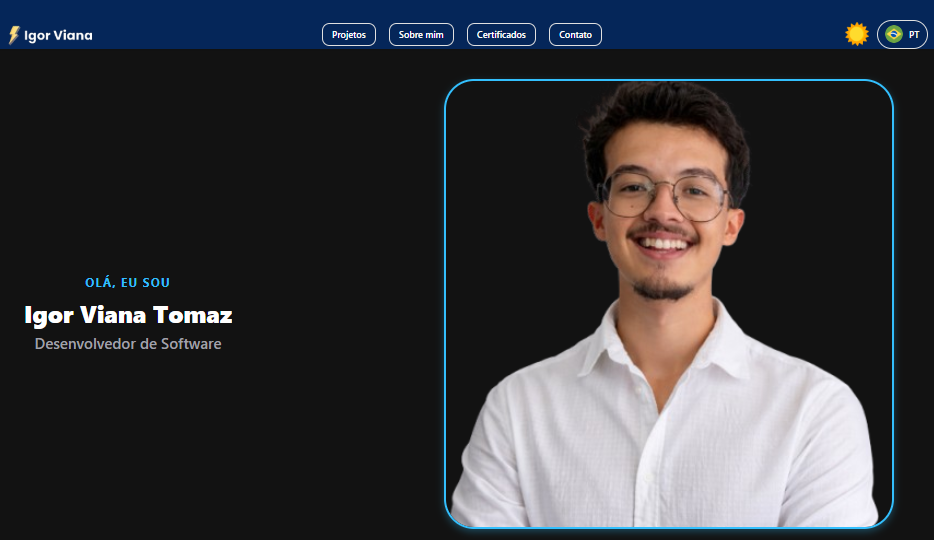

# Portfólio - Igor Viana Tomaz

Portfólio pessoal desenvolvido com React Native + Expo, com suporte para Web e Mobile.

<div align="center">
  
  <br><br>
  <a href="https://igor-viana-portifolio.vercel.app/">CLIQUE AQUI PARA ACESSAR O PORTFÓLIO ONLINE</a>
  <br>
</div>

## Tecnologias Utilizadas

- React Native (Expo)
- Expo Router
- TypeScript
- Context API (tema e idioma)
- Expo AV

## Funcionalidades

- Layout responsivo para celular, tablet e desktop
- Suporte a tema claro/escuro
- Suporte a multiplos idiomas (PT/EN/ES)
- Carrossel de projetos e certificados
- Visualizacao ampliada de certificados ao tocar na miniatura
- Apresentacao em video com transcricao sincronizada

## Como rodar o projeto localmente

1. Clone o repositorio:
```bash
git clone https://github.com/igorvt23/PORTIFOLIO.git
cd PORTIFOLIO
```

2. Instale as dependencias:
```bash
npm install
```

3. Inicie o projeto:
```bash
npm run start
```

4. No terminal do Expo:
- pressione `w` para abrir no navegador
- pressione `a` para abrir Android (emulador)
- pressione `i` para abrir iOS (simulador no macOS)

## Como rodar no celular (Expo Go)

1. Instale o app `Expo Go` no celular.
2. No PC, rode:
```bash
npm run start
```
3. Com o app Expo Go:
- Android: escaneie o QR code exibido no terminal
- iPhone: abra a camera e escaneie o QR code

## Se nao conectar no celular

- Garanta que PC e celular estejam na mesma rede Wi-Fi.
- Se ainda falhar, rode com tunel:
```bash
npx expo start --tunnel
```

## Scripts uteis

- `npm run start` inicia o Expo
- `npm run web` abre a versao web
- `npm run android` abre no Android
- `npm run ios` abre no iOS
- `npm run lint` executa o lint

## Contato

<div align="center">
  <a href="https://www.linkedin.com/in/igor-viana-tomaz-080583238" target="_blank">
    
  </a>
  <a href="https://www.instagram.com/_hey.igors" target="_blank">
    
  </a>
</div>

- **Email**: igorvianat@gmail.com

---

<div align="center">
  Desenvolvido por Igor Viana Tomaz
</div>
